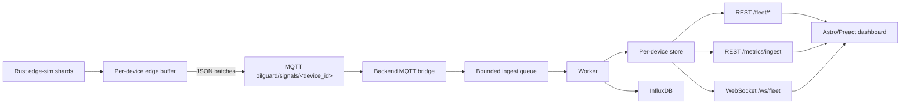

# Telemetry architecture

The telemetry path is a bounded, inspectable pipeline: the Rust edge simulator
creates deterministic signal rows, MQTT transports device batches, and the
backend exposes stored and aggregated data to the dashboard. Every boundary
keeps the device identity visible so queueing, drops, signatures, and latency
can be measured rather than inferred.

## Data flow

The backend bridge only decodes and enqueues. The worker verifies rows,
updates the per-device in-memory retention store, and flushes InfluxDB. The
queue is bounded; a full queue produces a counted drop instead of unbounded
memory growth. See [`backend/API.md`](../backend/API.md) for endpoint and
backpressure contracts.

## Contract and integrity

The row schema is defined once in
[`sim/SCHEMA.md`](../sim/SCHEMA.md); this document intentionally does not
duplicate its fields or units. MQTT batches use
`{"rows": [<SignalRow>, ...]}` on the per-device topic
`oilguard/signals/<device_id>`.

`ogs1` signs canonical row bytes with HMAC-SHA256. Each device key is derived
from a configured master key and the device ID, so the simulator and backend
can agree without storing a key list for every synthetic device. This is row
integrity and shared-key origin verification, not confidentiality, transport
security, HTTP authentication, or IEC 62443 compliance.

## Parity strategy

The Python generator remains the reference implementation. Rust parity is
checked by committed fixtures:

| Evidence | What it proves |
|---|---|
| Generator golden rows | Row values and formatting match the Python output |
| Signing vectors | `ogs1` canonicalization, HMAC signatures, and derived keys match |
| Physics fixture | Geometry and pressure calculations match within the fixture tolerance |

The executable checks live in
[`edge-sim/tests/parity.rs`](../edge-sim/tests/parity.rs). Realtime mode changes
only wall-clock `t_iso`; deterministic `t_s` and `seq` remain the same.

## Deliberate rejections

| Option | Decision | Reason |
|---|---|---|
| DuckDB | Rejected | Polars provides the required in-memory windowed aggregations with one fewer engine |
| Apache ECharts | Rejected | It adds a large dashboard dependency; the existing SVG chart keeps the Astro bundle smaller |
| Ore-grade, fuel, and GPS schema | Rejected | Those fields belong to another product and would break the existing wheel-oil contract and analytics |
| Binary payloads for now | Rejected for now | JSON preserves the backend contract and debuggability; binary batching is deferred until measurements prove JSON is the bottleneck |

The existing wheel-oil schema is therefore retained, and synthetic telemetry
is documented as synthetic rather than presented as field measurements.
